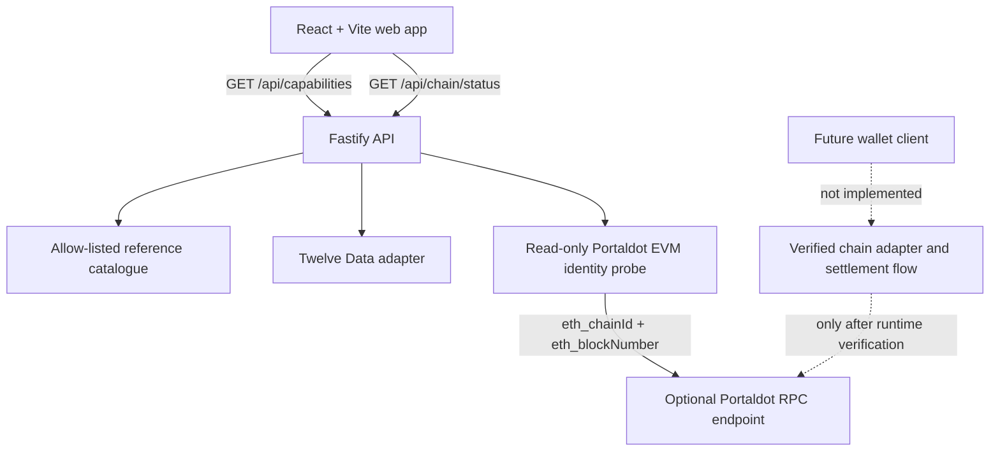

# PASTX Architecture

**Status:** the web preview, shared domain contracts, market-data adapter and HTTP market API are scaffolded. The API is implemented in source; the provider and CI tests must pass before considering the integration verified. Portaldot wallet/settlement integration is not implemented.

## Goals

- Deliver a usable market-discovery and trading experience.
- Isolate external market-data vendors from the UI.
- Isolate Portaldot runtime details behind a typed chain adapter.
- Keep wallet signing under the user's wallet.
- Make order status auditable from transaction evidence.
- Keep the MVP small enough to deliver and test within the hackathon.

## Current workspace

- `apps/web`: React + TypeScript + Vite market-terminal preview.
- `apps/api`: Fastify API, validation, rate limiting, safe errors, server-only provider key, and a machine-readable capability contract for frontend feature gating.
- `packages/shared`: market catalogue, domain types, candle intervals, API error contract and reusable non-executable order-preview arithmetic.
- `packages/market-data`: vendor adapter for Twelve Data, normalized quotes/candles and provider error mapping.
- `packages/chain-adapter`: read-only EVM RPC chain-and-latest-block probe; no transaction signing or submission.
- `packages/sdk`: planned until public interfaces are proven.
- `docs/`: architecture, API contract, settlement decisions, security, testing and deployment.

## System boundaries

The browser must not contain provider secrets. The UI can use `/api/capabilities` as the authoritative feature-gating contract; it distinguishes code being implemented from a feature being enabled. Quote/candle capability is enabled only when both the server-side provider key and explicit display flag are present. The UI stays on labelled fixtures otherwise. The API must never request or store a user's wallet seed phrase or private key. The capability document explicitly marks wallet connection, on-chain balances, order submission, transaction history and atomic settlement as not implemented, and it never enables trading.

## Market data

The catalogue currently contains AAPL, NVDA, TSLA and MSFT as **reference instruments**. They are external price references, not equity tokens and not executable on-chain assets. Quote and candle routes use Twelve Data via `MARKET_DATA_API_KEY`. The provider's free/basic terms distinguish internal non-display usage from client-facing external display; do not publicly display live provider data until the account and licensing tier are confirmed. The UI therefore remains clearly labelled as fixture/sample data until a permitted provider configuration and end-to-end display integration are verified.

The adapter uses bounded timeouts, normalized timestamps/numbers, response-shape checks, OHLC validation, stable error mapping, and no provider-detail leakage. It does not guess whether data is delayed.

## Chain-adapter boundary

The published [Portaldot V3 testnet guide](https://github.com/ItsCogumellum/portaldot-v3-testnet-guide) documents the EVM JSON-RPC endpoint `https://testnetv3-eth-rpc.feso-apps.xyz`, chain ID `420420777`, Solidity execution through `revive`, and an H160-to-native-SS58 mapping through `reviveApi.accountId`. The current PASTX adapter performs a read-only `eth_chainId` and latest-block read and has automated tests for those responses. Live endpoint reachability and wallet/account mapping have not yet been demonstrated. Passing this probe does not establish that the endpoint is canonical, nor does it prove account mapping, balance reads, transaction simulation, receipt verification, asset interoperability, or safe settlement.

Native `assets` tokens and Solidity contracts under `revive` are separate asset/execution models in the guide; interoperability and direct cross-module atomicity are not established. Keep PASTX trading disabled until the selected asset/payment route is tested end-to-end.

Proposed operations:
- `getNetworkInfo()`
- `getAssetMetadata(assetId)`
- `getBalance(account, assetId)`
- `prepareOrder(intent)`
- `submitOrder(preparedOrder, wallet)`
- `getSettlementStatus(txHash)`
- `getTransactionReceipt(txHash)`

These are app-level abstractions, not verified names of Portaldot RPC methods. Implementations must be backed by runtime inspection and integration tests.

## Settlement boundary

The MVP must not assume that native Assets, Solidity contracts, wallets, or runtime pallets interoperate. Choose one verified asset/payment path. A completed trade must meet explicit on-chain success conditions; submitted or included transactions alone are not enough if the required state transition failed.

See [Settlement Design](SETTLEMENT-DESIGN.md).

## Architectural decisions

- Start as a modular monolith, not microservices.
- Use a server-side market-data adapter to protect keys and normalize provider responses.
- Use PostgreSQL only when there is a concrete need for durable records or indexed chain history.
- Add Redis only if measured caching, rate limiting or job coordination needs justify it.
- Defer cross-chain bridges, matching engines and authentication expansion until the core flow works.

## Reference-only order intent domain

The shared package owns deterministic order-preview validation so the web app does not maintain separate arithmetic. It accepts a known reference-catalogue symbol, a buy/sell side, bounded positive quantity, and positive finite reference price. The result is explicitly `executable: false`; it is not an order, balance check, authorization, or transaction. Live trading remains disabled.
